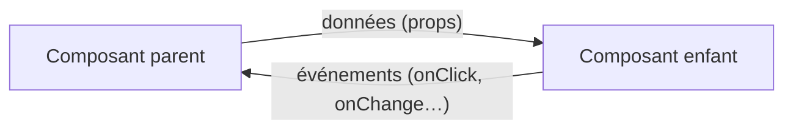
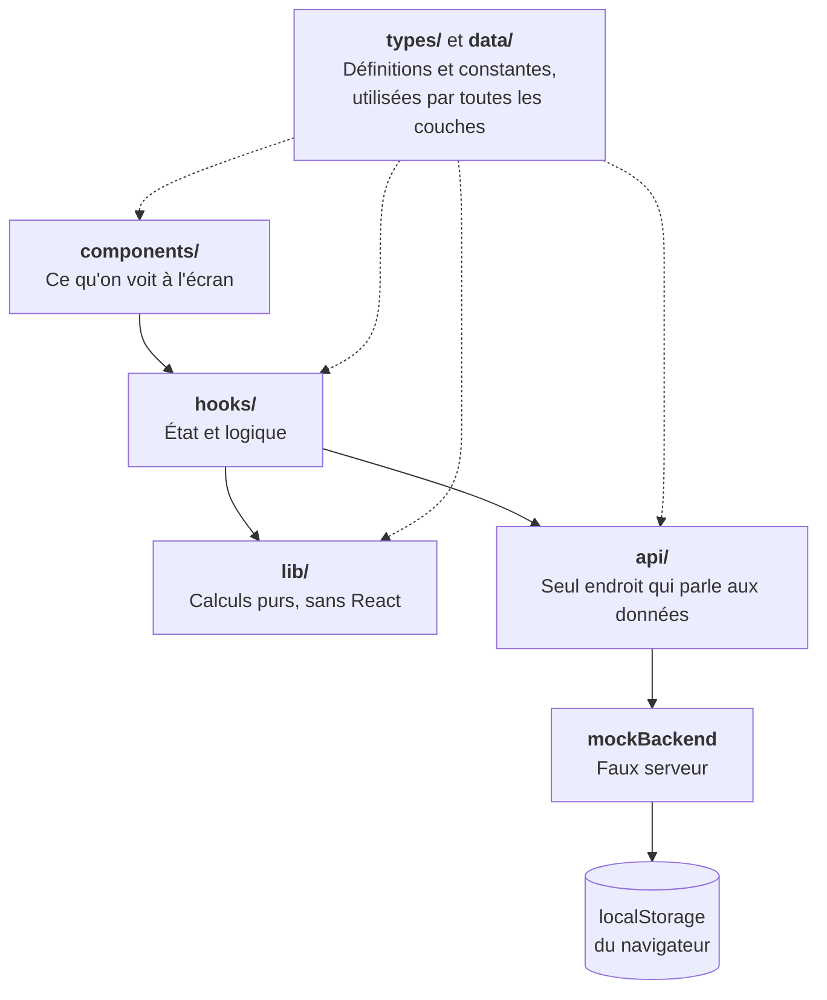
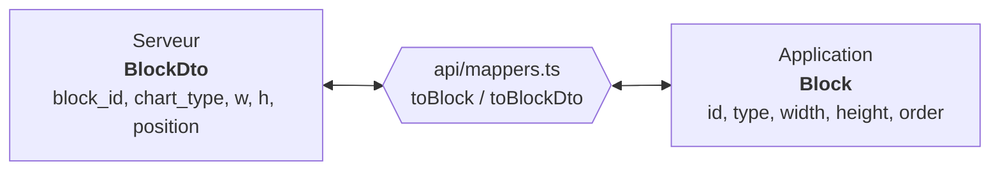
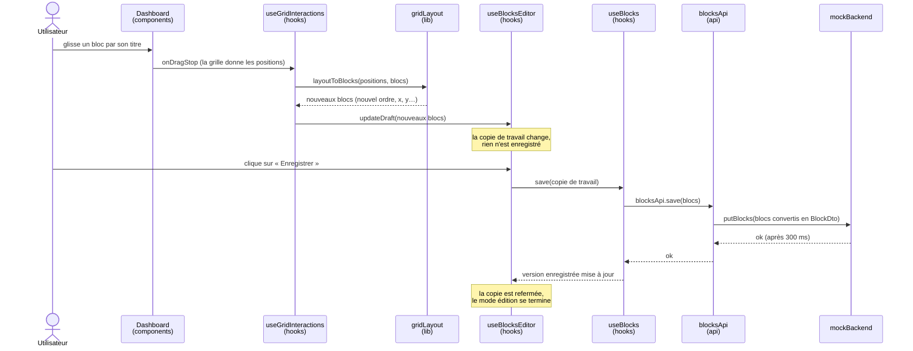
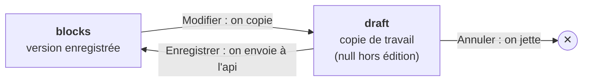
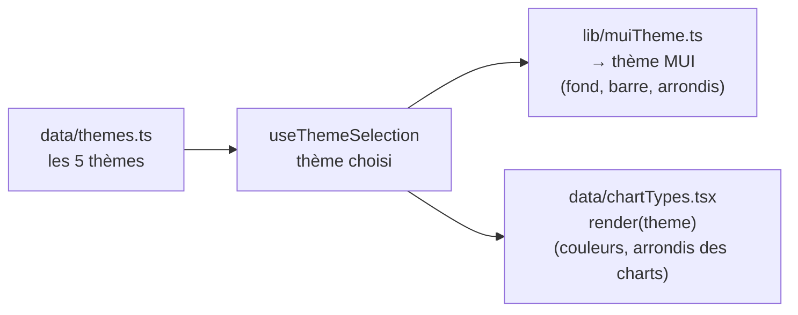

# Comment Mumuse est construite

Mumuse est un **tableau de bord de charts** que l'on peut réorganiser : chaque chart est un *bloc* que l'on déplace, redimensionne et verrouille sur une grille.

> **À qui s'adresse ce document ?** À quelqu'un qui découvre React. Les mots techniques sont expliqués au fur et à mesure, et la section 3 résume React en cinq minutes.

**Sommaire**

1. [L'essentiel en 30 secondes](#1-lessentiel-en-30-secondes)
2. [Lancer le projet](#2-lancer-le-projet)
3. [React en 5 minutes](#3-react-en-5-minutes)
4. [Les couches de l'application](#4-les-couches-de-lapplication)
5. [Où est quoi ?](#5-où-est-quoi-)
6. [Le bloc : la donnée centrale](#6-le-bloc--la-donnée-centrale)
7. [Les deux dispositions](#7-les-deux-dispositions)
8. [Un parcours complet : déplacer puis enregistrer](#8-un-parcours-complet--déplacer-puis-enregistrer)
9. [Le mode Modifier en détail](#9-le-mode-modifier-en-détail)
10. [Thèmes et charts](#10-thèmes-et-charts)
11. [Recettes : modifier l'application](#11-recettes--modifier-lapplication)
12. [Règles de code](#12-règles-de-code)
13. [Limites connues](#13-limites-connues)

---

## 1. L'essentiel en 30 secondes

- **Une seule page** : une barre en haut, puis une grille de blocs.
- **Chaque bloc** affiche un chart (barres, donut, courbe, nuage de points, jauge).
- **Le bouton « Modifier »** ouvre le mode édition : on déplace un bloc par son titre, on le redimensionne par ses bords et ses coins, on le verrouille avec le cadenas. **Enregistrer** valide, **Annuler** revient en arrière.
- **Deux dispositions** (boutons dans la barre) : *automatique* (les blocs se rangent tout seuls) ou *libre* (chaque bloc reste exactement où on l'a posé).
- **Cinq thèmes** (boutons dans la barre) changent les couleurs et les formes.
- **Pas de vrai serveur** pour l'instant : les données viennent d'un *faux serveur* (`mockBackend`) qui stocke tout dans le navigateur. Le jour où un vrai backend existe, un seul dossier change.

**Technologies :** React 19 · TypeScript (mode strict) · Vite · MUI (composants) · MUI X Charts (les charts) · react-grid-layout (la grille déplaçable).

---

## 2. Lancer le projet

```bash
npm install        # installe les dépendances (une seule fois)
npm run dev        # lance l'application en local (http://localhost:5173)
npm run build      # vérifie les types (tsc) puis fabrique la version de production
npm run lint       # cherche les erreurs de style et les pièges courants
```

Chaque `git push` sur la branche `main` déclenche un build chez Cloudflare, qui met le site en ligne.

---

## 3. React en 5 minutes

Pour lire le code, il suffit de connaître cinq idées.

| Idée | En clair | Exemple dans le projet |
|---|---|---|
| **Composant** | Une fonction qui renvoie ce qu'on voit à l'écran (du « JSX », qui ressemble à du HTML). | `TopBar` dans `components/TopBar.tsx` |
| **Props** | Les arguments d'un composant : ce que son parent lui donne. | `<TopBar editing={true} … />` |
| **État** (`useState`) | La mémoire d'un composant. Quand elle change, l'écran se met à jour tout seul. | `const [draft, setDraft] = useState(null)` |
| **Effet** (`useEffect`) | Du code lancé *après* l'affichage, par exemple pour charger des données. | le chargement des blocs dans `useBlocks` |
| **Hook perso** (`useXxx`) | Une fonction qui regroupe un état et la logique qui va avec, pour alléger les composants. | `useBlocks`, `useBlocksEditor` |

**La règle de lecture la plus utile :**



Les **données descendent** du parent vers l'enfant, et les **événements remontent** de l'enfant vers le parent, par des fonctions appelées `onQuelqueChose`. Par exemple, `TopBar` ne sait pas *comment* enregistrer : il appelle `onSaveEditing`, et c'est `App` qui lui a donné cette fonction.

---

## 4. Les couches de l'application

Le code est rangé en couches. **Une couche ne connaît que celle qui est juste en dessous**, ce qui permet de changer l'une sans casser les autres.



- **`components/`** affiche. Il reçoit tout par props et ne sait pas d'où viennent les données.
- **`hooks/`** garde l'état (blocs, thème, mode édition…) et décide quoi faire.
- **`lib/`** contient des fonctions « pures » : mêmes entrées, mêmes sorties, aucun effet de bord. Ce sont les plus faciles à comprendre et à tester.
- **`api/`** est la porte d'entrée des données. Aucun composant ni hook ne fait de `fetch` ni n'écrit dans le `localStorage` : tout passe par ici.

> **Pourquoi une couche `api/` alors qu'il n'y a pas de serveur ?** Pour que le jour où il y en a un, on remplace `mockBackend.ts` et rien d'autre. Le faux serveur imite déjà un vrai : il répond avec un délai (300 ms) et peut échouer, ce qui permet de tester les écrans de chargement et d'erreur.

---

## 5. Où est quoi ?

```
src/
├── main.tsx                      Démarre l'application
├── App.tsx                       Assemble les hooks et les composants
├── App.css                       Tous les styles de mise en page
│
├── components/                   AFFICHAGE
│   ├── TopBar.tsx                Barre du haut : thèmes, dispositions, Modifier/Enregistrer/Annuler
│   ├── BlocksArea.tsx            Choisit quoi montrer : chargement, erreur, vide ou grille
│   ├── Dashboard.tsx             La grille de blocs (react-grid-layout)
│   ├── BlockCard.tsx             Un bloc : titre, chart, cadenas, bouton plein écran
│   ├── FullscreenBlockDialog.tsx Un bloc en plein écran
│   ├── GridGhost.tsx             Cadre qui montre la taille aimantée pendant un redimensionnement
│   └── StateMessage.tsx          Message centré (chargement, erreur, liste vide)
│
├── hooks/                        ÉTAT ET LOGIQUE
│   ├── useBlocks.ts              Charge et enregistre les blocs (statut loading/error/ready)
│   ├── useBlocksEditor.ts        Mode Modifier : copie de travail, enregistrer, annuler
│   ├── useLayoutMode.ts          Disposition automatique ou libre, et bascule entre les deux
│   ├── useThemeSelection.ts      Thème choisi
│   ├── useGridInteractions.ts    Relie la souris (déplacer, redimensionner) à nos règles
│   └── useUnsavedChangesWarning.ts  Avertit si on ferme la page avec des modifications en cours
│
├── lib/                          CALCULS PURS
│   ├── gridLayout.ts             Blocs ↔ grille (point d'entrée), ordre de lecture
│   ├── autoLayout.ts             Disposition automatique
│   ├── freeLayout.ts             Disposition libre (et colonne unique sur écran étroit)
│   ├── responsive.ts             Mise à l'échelle de la disposition libre selon la largeur d'écran
│   ├── layoutItem.ts             Briques communes : taille minimale, chevauchement…
│   ├── snapping.ts               Aimantation douce (voisins, pas de 10 px)
│   ├── blocks.ts                 Comparer deux listes de blocs, verrouiller un bloc
│   └── muiTheme.ts               Notre thème → thème MUI
│
├── api/                          ACCÈS AUX DONNÉES
│   ├── blocksApi.ts              Lire / enregistrer les blocs
│   ├── preferencesApi.ts         Lire / enregistrer thème et disposition
│   ├── dtos.ts                   Forme des données côté serveur
│   ├── mappers.ts                Conversion forme serveur ↔ forme de l'application
│   └── mockBackend.ts            Faux serveur (délai, échecs possibles, localStorage)
│
├── data/                         CONSTANTES
│   ├── themes.ts                 Les 5 thèmes
│   └── chartTypes.tsx            Les 5 types de charts et leur dessin
│
└── types/                        DÉFINITIONS
    ├── block.ts                  Block, ChartType
    ├── layoutMode.ts             'auto' | 'free'
    └── theme.ts                  AppTheme
```

---

## 6. Le bloc : la donnée centrale

Tout tourne autour d'un objet, le **bloc** (`types/block.ts`) :

| Champ | Sens |
|---|---|
| `id` | Identifiant unique et stable (sert de clé à React et à la grille) |
| `type` | Type de chart : `bar`, `donut`, `line`, `scatter` ou `gauge` |
| `width`, `height` | Taille en **pixels** |
| `order` | Rang de lecture : de gauche à droite, puis ligne par ligne |
| `x`, `y` | Position en pixels depuis le coin haut-gauche de la grille |
| `locked` | Verrouillé : ne bouge pas et personne ne peut prendre sa place |

**Responsive en disposition libre** (`lib/responsive.ts`) : en libre, `x` et `width` sont enregistrés pour une largeur de référence de 1200 px puis mis à l'échelle de la largeur réelle (les hauteurs restent en pixels). Sous 700 px, les blocs s'empilent en une colonne (dans l'ordre de lecture) et on ne peut plus les déplacer ni les verrouiller. La disposition automatique est déjà fluide.

**Qui utilise `x` et `y` ?** Tous les blocs en disposition *libre* ; seulement les blocs *verrouillés* en disposition *automatique*. Les autres ont leur position recalculée à partir de `order`.

### Deux formes pour un même bloc

Le serveur n'utilise pas forcément les mêmes noms que l'application. On a donc deux types distincts, avec une fonction de conversion entre les deux :



Si le backend renomme un champ, on ne change que `dtos.ts` et `mappers.ts` : le reste de l'application ne s'en aperçoit pas.

### Ce qui est enregistré, et où

Pour l'instant, dans le `localStorage` du navigateur (donc propre à ce navigateur et cet appareil) :

| Clé | Contenu |
|---|---|
| `mumuse-api-blocks` | La liste des blocs, au format serveur (`BlockDto`) |
| `mumuse-theme` | Le numéro du thème choisi |
| `mumuse-layout-mode` | `"auto"` ou `"free"` |

---

## 7. Les deux dispositions

La grille est réglée pour qu'**une unité vaille un pixel** : la largeur d'un bloc dans la grille est directement sa largeur en pixels.

| | **Automatique** | **Libre** |
|---|---|---|
| Idée | Les blocs coulent comme du texte, dans l'ordre | Chaque bloc reste où on l'a posé |
| Qui décide de la position ? | L'application, d'après `order` | L'utilisateur, d'après `x` et `y` |
| Vide entre les blocs | Non, tout est tassé | Oui |
| Un bloc déposé sur un autre | Les blocs se réorganisent | Refusé : le bloc revient à sa place |
| Code | `lib/autoLayout.ts` | `lib/freeLayout.ts` |

```
 AUTOMATIQUE : ordre 0 → 1 → 2 → …, retour à la ligne quand c'est plein

   ┌──────┐ ┌──────┐
   │  0   │ │  1   │
   └──────┘ └──────┘
   ┌──────┐ ┌──────────┐
   │  2   │ │    3     │
   └──────┘ └──────────┘


 LIBRE : chaque bloc à sa position, avec du vide autour

   ┌──────┐            ┌──────┐
   │  0   │            │  1   │
   └──────┘            └──────┘

            ┌──────────┐
            │    3     │
            └──────────┘
   ┌──────┐
   │  2   │
   └──────┘
```

### Le verrouillage

Un bloc verrouillé est **figé à sa position** (`x`, `y`) dans les deux dispositions. En automatique, les autres blocs *contournent* son emplacement : s'ils devaient s'y poser, ils sautent à sa droite ou passent à la ligne. C'est ce qui garantit qu'aucun bloc ne prend la place d'un bloc verrouillé.

### Changer de disposition

Les deux boutons de la barre ne font rien sauter à l'écran. Avant de basculer, l'application **convertit** les blocs : les positions actuellement affichées deviennent leurs `x`, `y` (automatique → libre), ou leur `order` (libre → automatique), puis elle enregistre.

> ⚠️ **Libre → automatique re-range tout dans l'ordre de lecture** : les espaces vides disparaissent. C'est voulu, mais on ne peut pas les retrouver en revenant à *libre*.

### L'aimantation douce

Quand on redimensionne (et quand on dépose un bloc en disposition libre), la valeur se cale d'abord sur celle d'un bloc voisin s'il est à moins de 12 px, sinon sur un multiple de 10 px. Maintenir **Maj** la désactive. Le code est dans `lib/snapping.ts`.

---

## 8. Un parcours complet : déplacer puis enregistrer

Ce schéma suit une action de bout en bout et montre quelle couche fait quoi.



À retenir : **déplacer ne sauvegarde rien**. On modifie une *copie de travail* ; seul « Enregistrer » l'envoie à la couche `api/`.

---

## 9. Le mode Modifier en détail

Deux versions des blocs coexistent (`hooks/useBlocksEditor.ts`) :



- **Modifier** copie les blocs dans `draft`. Tant que `draft` existe, on est en mode édition.
- Pendant l'édition, l'écran affiche `draft`. Chaque déplacement, redimensionnement ou verrouillage remplace `draft`.
- **Annuler** supprime `draft` (avec une confirmation s'il y avait des changements). L'écran revient à la version enregistrée.
- **Enregistrer** envoie `draft` à l'api. **Si l'envoi échoue**, on reste en édition et on affiche un message : rien n'est perdu.
- Le repère **« ● Modifications non enregistrées »** apparaît quand `draft` diffère de la version enregistrée (`lib/blocks.ts`). Si on ferme la page dans cet état, le navigateur demande confirmation.

**Seule la barre du titre déplace un bloc.** Cliquer dans le chart ne fait rien, pour éviter les déplacements par mégarde.

---

## 10. Thèmes et charts



- Un thème est un simple objet (`types/theme.ts`) : couleur principale, fond, palette des charts, arrondis, etc.
- Il s'applique **deux fois** : au thème MUI (la barre, les cartes, le fond) et à chaque chart (via `chartTypes.render(theme)`).
- Le **thème 1** est le rendu MUI d'origine : `plain: true` et pas de palette, pour garder les réglages par défaut de MUI.
- Chaque type de chart (`data/chartTypes.tsx`) est une petite fonction qui reçoit le thème et renvoie le chart avec les bons réglages.

---

## 11. Recettes : modifier l'application

### Ajouter un type de chart

1. Dans `types/block.ts`, ajouter son nom à la liste `CHART_TYPES` (par exemple `'radar'`).
2. Dans `data/chartTypes.tsx`, ajouter une entrée avec son titre et la fonction `render(theme)` qui renvoie le chart.
3. TypeScript signale tout ce qui manque : tant que `tsc` n'est pas content, il reste quelque chose à faire.

### Ajouter un thème

Ajouter un objet à la liste de `data/themes.ts`, en copiant un thème existant. Son bouton apparaît tout seul dans la barre.

### Brancher un vrai backend

Dans `api/`, remplacer les appels à `mockBackend` (dans `blocksApi.ts` et `preferencesApi.ts`) par de vrais appels réseau (`fetch`). Si le serveur utilise d'autres noms de champs, adapter `dtos.ts` et `mappers.ts`. Les hooks, les composants et `lib/` ne changent pas.

### Tester l'écran d'erreur

Dans `api/mockBackend.ts`, mettre `failureRate` à `1` : toutes les requêtes échouent. On voit alors « Impossible de charger les blocs » avec son bouton « Réessayer », et le message d'échec à l'enregistrement. Remettre `0` ensuite.

### Repartir de zéro

Les données sont dans le navigateur. Dans la console (F12), `localStorage.clear()` puis recharger la page remet les blocs, le thème et la disposition par défaut.

### Voir la liste des blocs

La console du navigateur (F12) affiche la liste des blocs au chargement et après chaque enregistrement.

---

## 12. Règles de code

Le code suit ces règles, pour rester simple à relire :

- **TypeScript strict, pas de `any`.** Chaque objet métier a un type nommé, défini une seule fois.
- **Données brutes séparées des types de l'application** (`BlockDto` et `Block`), avec un mapper.
- **Un fichier, une responsabilité.** Un composant fait moins d'une centaine de lignes ; l'état va dans les hooks, les calculs dans `lib/`.
- **Aucun accès aux données hors de `api/`** : pas de `fetch` ni de `localStorage` ailleurs.
- **Chargement, erreur et vide** sont toujours gérés.
- **Pas de valeurs « magiques »** : un nombre qui a un sens devient une constante nommée.
- **Commentaires en français qui expliquent le pourquoi**, et un commentaire d'en-tête dans chaque fichier.
- **Styles dans `App.css`**, pas éparpillés dans le code (sauf les valeurs qui dépendent du thème, gérées par MUI).

---

## 13. Limites connues

- **Aucun test automatique** pour l'instant : les vérifications ont été faites à la main dans le navigateur. Les fonctions de `lib/` sont les meilleures candidates pour de premiers tests, car elles sont pures.
- **Les données restent dans le navigateur** : une autre machine ou un autre navigateur repart de la disposition par défaut.
- **Redimensionner la fenêtre en direct** n'a pas pu être testé dans l'outil de test (l'animation du navigateur y est suspendue) : chaque largeur a été testée à froid, page rechargée.
- **Pas encore de gestion des blocs** : on ne peut ni ajouter, ni supprimer, ni dupliquer un bloc depuis l'interface (les cinq blocs viennent de `mockBackend.ts`).
